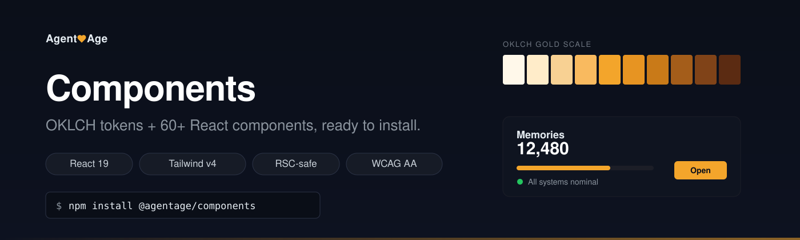

# @agentage/components



OKLCH design tokens and 60+ accessible React 19 components in one package. Install it, import
the theme, and you have a coherent dark/light UI kit - buttons through data tables, stat cards,
command palettes and docs layouts.

Browse every component live at **[ds.agentage.io](https://ds.agentage.io)**.

## Moving from `@agentage/design-system`

`@agentage/design-system` is frozen at 0.20.2 for the apps that still use it. To move to
`@agentage/components`:

1. Swap the package: `npm uninstall @agentage/design-system && npm install @agentage/components`.
2. Replace `@agentage/design-system` with `@agentage/components` in imports, in the CSS import
   (`@agentage/components/theme.css`) and in the Tailwind `@source` glob
   (`node_modules/@agentage/components/dist/**/*.js`). Subpaths keep their names.
3. Expect the denser look: 28 px buttons, 30 px fields, 36 px rows, flat 12/14 px cards. The
   "Catalog review" page in the showcase lists every visual change.
4. Every 0.20.2 export and prop still works. Deprecated names (`density`, `variant="flat"`,
   Button `lg`, MiniBars `color` and others) are marked `@deprecated` in the types; replace them
   when your editor flags them.

## What is this?

The component library behind the Agentage dashboard, admin console and public sites, published as a
plain npm package so anything can use it.

It is deliberately unopinionated about your framework. It ships **standard ESM with one file per
component**, so tree-shaking works, and every interactive component already carries `'use client'`,
so it drops into a Next.js App Router server tree without wrappers or `dynamic()` tricks. Colors
are defined in [OKLCH](https://oklch.com), so the light and dark themes are perceptually matched
rather than hand-tuned, and contrast holds up under WCAG AA.

## Get started

### 1. Install

```bash
npm install @agentage/components
```

Peers: `react` and `react-dom` >= 19. `tailwindcss` >= 4 is an optional peer - the components
carry Tailwind utility classes, so you need it unless you ship your own compiled CSS.

### 2. Load the theme

```tsx
// app/layout.tsx (or your root entry)
import '@agentage/components/theme.css';
```

### 3. Point Tailwind at the shipped bundle

```css
/* globals.css - Tailwind v4, CSS-first config */
@import 'tailwindcss';
@import '@agentage/components/theme.css';

@source "../../node_modules/@agentage/components/dist/**/*.js";
```

> Tailwind must scan the **shipped JS**, not the source, or every component class is
> tree-shaken out of your build. The glob has to resolve to wherever npm actually hoisted the
> package - in a workspace that is the repo-root `node_modules`, not the package-local one. This
> is the single most common cause of "the components render unstyled".

### 4. Use it

```tsx
import { Button, Card, CardHeader, CardTitle, StatCard } from '@agentage/components';

export const Panel = () => (
  <Card>
    <CardHeader>
      <CardTitle>Storage</CardTitle>
    </CardHeader>
    <StatCard title="Stored" value="12,480" progress={64} />
    <Button>Open</Button>
  </Card>
);
```

Full walkthrough: [ds.agentage.io/install](https://ds.agentage.io/install).

## What's in it

100 documented component pages across eleven categories, each with props generated from the source.
33 of them form the **Core** set: the pieces an app needs first (Button, Card, Table, DataTable, Tabs,
Input, Modal, Toast and more). The Core pages sit at the top of the docs sidebar.

| Category                                                            | What's there                                                                                                                                                      |
| ------------------------------------------------------------------- | ----------------------------------------------------------------------------------------------------------------------------------------------------------------- |
| [Foundations](https://ds.agentage.io/components/foundations) (14)   | Button, IconButton, Badge, Chip, Avatar, Kbd, Separator, Skeleton and Spinner, status and priority glyphs, Heading, Prose, Label, accessibility hooks             |
| [Forms](https://ds.agentage.io/components/forms) (13)               | Input and Textarea, SecretInput, Select, Combobox, TreeSelect, DatePicker, Checkbox and Switch, RadioGroup, Slider, ToggleGroup, FormField, Section, InlineEdit   |
| [Navigation](https://ds.agentage.io/components/navigation) (7)      | NavRow and NavTree, Sidebar, Tabs, Breadcrumb, Pagination, SectionIndex, PageHeader                                                                               |
| [Lists and tables](https://ds.agentage.io/components/lists) (6)     | List, Table, DataTable, DataView, ListToolbar, GroupHeader                                                                                                        |
| [Data display](https://ds.agentage.io/components/data-display) (12) | Card, EntityCard, StatCard, DescriptionList, Progress, StatusBar, RelativeTime, LogView, DataTree, CodeBlock, ContentBlocks, EmptyState                           |
| [Disclosure](https://ds.agentage.io/components/disclosure) (4)      | Collapsible, Accordion, StepList, CheckList                                                                                                                       |
| [Overlays](https://ds.agentage.io/components/overlays) (13)         | Modal, Sheet, AlertDialog, InspectorPanel, Popover, HoverCard, Tooltip, DropdownMenu, ContextMenu, Command palette, Resizable panels, ScrollArea, overlay portals |
| [Feedback](https://ds.agentage.io/components/feedback) (7)          | Alert, Toast, DirtyBar, ActionBar, DangerZone, ConfirmByTyping, QuotaBanner                                                                                       |
| [Patterns](https://ds.agentage.io/components/patterns) (11)         | List page, card grid, catalog with views, board, master and detail, detail view, history, settings form, logs explorer, file browser, monitoring                  |
| [Charts](https://ds.agentage.io/components/charts) (8)              | Gauge, donut, score, funnel, heatmap, multi-stat and ranked-list cards, sparkline and stat parts                                                                  |
| [Site](https://ds.agentage.io/components/site) (5)                  | Footer, TopBar, DocSidebar, MarkdownRenderer, CopyButton                                                                                                          |

Beside the pages, composable parts (`CardHeader`, `TableRow`, `CommandItem` and friends) and
focus-trap, scroll-lock and anchor-positioning hooks are exported too. Every module has a
per-component subpath in the [exports map](./package.json).

## Server components

Every interactive component ships `'use client'` as line 1 of its emitted module, and the build
preserves one output file per source module. So the barrel is safe to import from a React Server
Component - only the components you actually use that need the client runtime cross the boundary.

```tsx
import { Card } from '@agentage/components/card'; // server-safe
import { Modal } from '@agentage/components/modal'; // 'use client', already declared
```

No server-safe module transitively imports a client module, so importing `Card` never drags a
client boundary into your server tree. Per-component subpaths exist for consumers who want to keep
that graph explicit; the barrel works too.

## Theming

Three tiers, composed by `theme.css`:

| Layer            | Import                                | What it holds                                       |
| ---------------- | ------------------------------------- | --------------------------------------------------- |
| `primitives.css` | `@agentage/components/primitives.css` | Raw OKLCH scales - 11 stops each, theme-independent |
| `tokens.css`     | via `theme.css`                       | Semantic tokens, typography, shadows                |
| `base.css`       | via `theme.css`                       | Element resets                                      |

Dark is the default. Switch with one attribute on `<html>`:

```tsx
document.documentElement.setAttribute('data-theme', 'light'); // dark | light | system
```

`system` follows `prefers-color-scheme`. Override any semantic token in your own CSS to rebrand
without forking - see [ds.agentage.io/theming](https://ds.agentage.io/theming).

## Requirements

| Requirement | Version | Note                                                |
| ----------- | ------- | --------------------------------------------------- |
| React       | >= 19   | Peer, required                                      |
| React DOM   | >= 19   | Peer, required                                      |
| Tailwind    | >= 4    | Optional peer - needed unless you ship your own CSS |
| Node        | >= 22   | Build/dev only; the package itself is browser code  |

Ships ESM only, with a `.d.ts` beside every module.

## Develop

```bash
npm install
npm run dev       # component showcase (Vite) on :5174
npm run verify    # type-check + lint + format + exports:check + test + build
npm run test:e2e  # Playwright: axe WCAG A/AA scan + screenshot baselines
```

- `src/components` - the components, barrel-exported from `src/index.ts`. Add `'use client'` as
  line 1 to anything using state, effects, refs, context, portals, DOM APIs or event handlers.
- `src/styles` - the OKLCH token and base-style CSS.
- `src/lib` - `cn` and helpers.
- `dev/` - the showcase deployed to ds.agentage.io.

Run `npm run exports:generate` after adding or renaming a component; `exports:check` fails
`verify` when the exports map drifts.

Regenerate Playwright screenshot baselines inside the CI image, never on the host - font metrics
must match:

```bash
docker run --rm --ipc=host -v "$PWD":/work -w /work -u "$(id -u):$(id -g)" -e HOME=/tmp \
  mcr.microsoft.com/playwright:v1.65.1-noble npx playwright test --update-snapshots
```

## Release

`prepare-release.yml` (dispatched, or run by hand) opens a `chore(release): X.Y.Z` PR and arms
auto-merge; on the merge `release.yml` runs `verify`, publishes with
`npm publish --access public --provenance` through npm trusted publishing (OIDC, no token) and tags
`vX.Y.Z`.

## Contributing

Issues and PRs welcome at
[github.com/agentage/components](https://github.com/agentage/components). Branch off
`master`, keep `npm run verify` green, and add a test when you change interactive behavior.

## License

MIT - see [LICENSE](./LICENSE).
